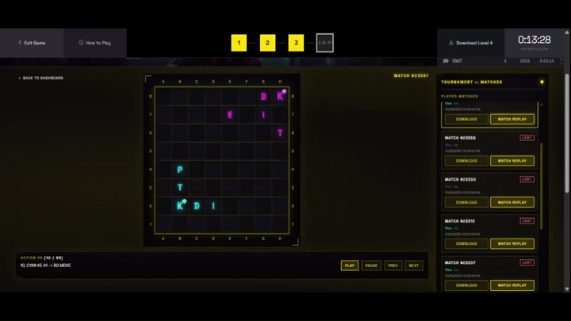
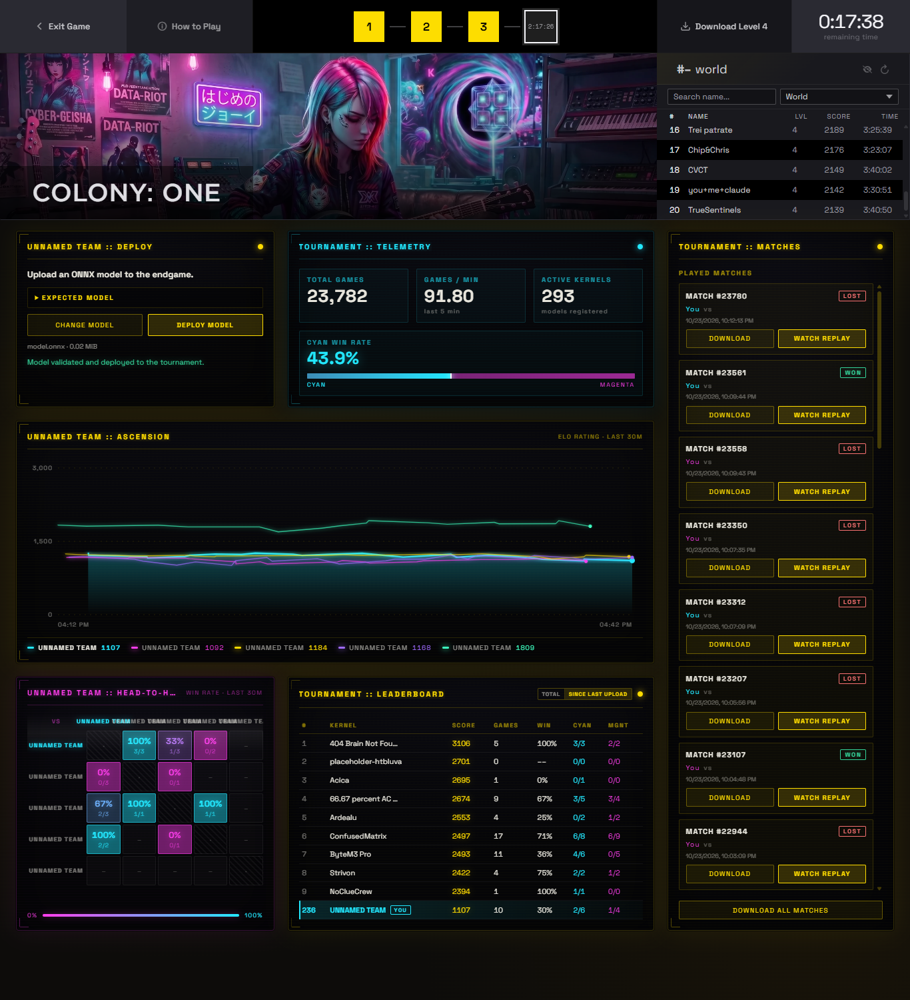

# Jennifer

[](https://github.com/sarthak-shubham/jennifer/actions/workflows/ci.yml)

Game engine and ONNX neural evaluator for [Colony: One](problem_statements/level-3/STARTER_KIT_README.md), built for the 42nd Cloudflight Coding Contest.

Covers all four levels: BFS safe pathfinding (L1), minimax forced-win solver (L2), and a 23.6 KB hand-compiled convolutional network running inside MCTS (L3/L4).



---

## Setup

```bash
pip install -e .
```

---

## Commands

Build the production ONNX model:

```bash
python model_builders/build_jennifer_cnn.py
```

Validate it against the competition contract:

```bash
python tools/validate_submission.py models/jennifer_tournament.onnx
```

Benchmark against the random baseline:

```bash
python tools/model_vs_model.py --model-a models/jennifer_tournament.onnx --model-b models/random_baseline.onnx --games 10
```

Run the deterministic solvers:

```bash
python solvers/level1_safe_pathfinder.py E4 H4 A4
python solvers/level2_minimax_solver.py C3 F5 F8
```

---

## Tournament Results (Level 4)

[](assets/dashboard_view.png)

| Metric | Value |
|:---|:---|
| Competing models | 293 |
| Total matches | 23,782 |
| Throughput | 91.80 matches / min |
| Deployed size | 23.6 KB (limit: 5 MB) |
| Levels cleared | 1, 2, 3, 4 |

Participation: [certificate](assets/participation_certificate.pdf)

---

## Architecture

See [docs/ARCHITECTURE.md](docs/ARCHITECTURE.md) for the state encoding, convolutional filter specifications, and policy/value head design.

---

## Author

**Sarthak Shubham** — [GitHub](https://github.com/sarthak-shubham)
