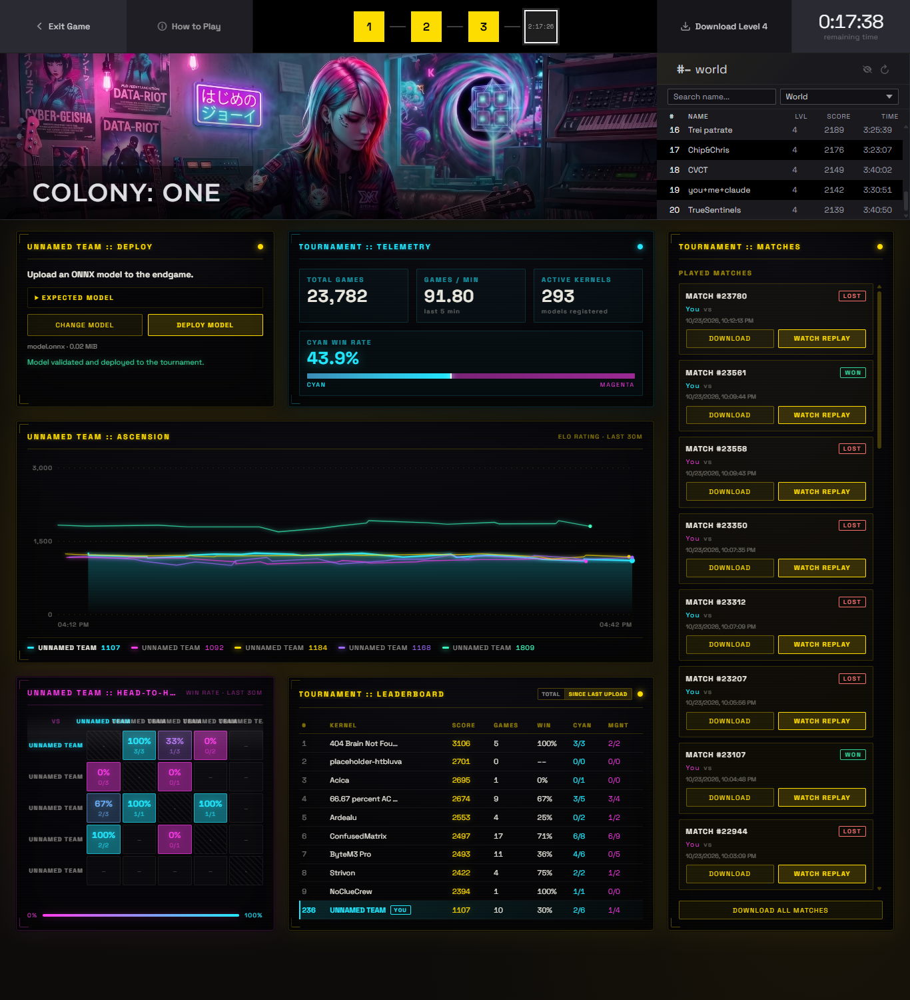

<div align="left">
  
  <br><br>
  <b>Tactical Neural Agent & Deterministic Puzzle Solvers for Colony: One</b><br>
  <i>Built for the 42nd Cloudflight Coding Contest (Data/AI Track)</i>
  <br><br>

  [](https://github.com/sarthak-shubham/jennifer/actions/workflows/ci.yml)
  
  
  
  
  
  
  <a href="assets/participation_certificate.pdf"></a>
</div>

---

## 📖 Overview

**Jennifer** is a tactical neural agent and algorithmic game engine engineered for **Colony: One**, a turn-based cyber-chess arena developed by Cloudflight. The game features 2 consecutive actions per turn, directional raycasting combat, piece escort mechanics (*The Bodyguard Rule*), and a shrinking perimeter firewall.

This repository covers the complete end-to-end engineering across all 4 competition levels:
* **Levels 1 & 2:** Deterministic algorithmic engines (raycast safe pathfinding & adversarial minimax search).
* **Levels 3 & 4:** Architecture evolution from linear value baselines to a production **$3 \times 3$ Tactical ConvNet** (`jennifer_tournament.onnx`, 23.6 KB) deployed live on Cloudflight's tournament servers.

---

## 🏆 Live Tournament Telemetry (Level 4)

During Level 4, Jennifer was compiled, validated, and deployed to Cloudflight's global multiplayer arena, competing in real-time matches evaluated by Cloudflight's Monte Carlo Tree Search (MCTS) referee.

<details>
<summary>📊 <b>Click to View Level 4 Tournament Dashboard (4K Telemetry)</b></summary>
<br>

<a href="assets/dashboard_view.png">
  
</a>

<p align="center"><i>Official Cloudflight Level 4 Tournament Dashboard (Click image to expand 4K telemetry view)</i></p>
</details>

<br>

### Global Competition Telemetry
| Metric | Platform Value | Details |
| :--- | :---: | :--- |
| **Competing Teams / Kernels** | **293 models** | Registered worldwide across AI tracks |
| **Total Arena Matches** | **23,782 games** | Real-time multi-agent games played |
| **Matches per Minute** | **91.80** | Concurrent server evaluation throughput |
| **Levels Cleared** | **Levels 1, 2, 3, 4** | Full platform progression achieved |
| **Deployed Binary Size** | **0.02 MiB (23.6 KB)** | Well within the strict 5.0 MB ceiling |
| **Head-to-Head Highs** | **100% win-rate** | Achieved against select rival teams (Match #23561, #23107) |

<details>
<summary>🎬 <b>Click to View Match Recording</b></summary>
<br>

▶️ **[Download / Watch Live Match Replay (`assets/match_recording.mp4`, 25.6 MB)](assets/match_recording.mp4)**

</details>

---

## ⚔️ Featured Match Breakdown (Turn 38 Checkmate)

In this verified tournament matchup, Jennifer commanded the **Cyan** team against **Magenta** (`SCENE bbb07676-7676-7676-7670-767600076bbb`), securing a forced checkmate in 38 plies:

### Tactical Key Moments
1. **Turn 21 (Daemon Sniping):** Cyan's Daemon executes a point-blank tactical shot (`DE D2 -> C3 SHOOT xEX`), eliminating Magenta's Exploit piece and establishing central board control.
2. **Turn 32 (Perimeter Evacuation):** In response to Firewall Round 8 closing in, Cyan shifts pieces off the outer edge toward interior rings.
3. **Turn 37–38 (Double-Strike Checkmate):** Cyan's Ice (`IC`) exploits an opening with a consecutive two-action kill:
   * **Action 37:** `IC E5 -> F6 MOVE xDE` (captures enemy Daemon).
   * **Action 38:** `IC F6 -> G7 MOVE xKE` (captures enemy Kernel for instant checkmate).

<details>
<summary>📜 <b>View Turn-by-Turn Match Log</b></summary>

```text
# CYAN vs MAGENTA
# SCENE bbb07676-7676-7676-7670-767600076bbb
  1. CYAN     IC  B2 -> D4  MOVE
  2. CYAN     DE  C1 -> C2  MOVE
  3. MAGENTA  DE  F8 -> G8  MOVE
  4. MAGENTA  PI  G5 -> G4  MOVE
  5. CYAN     TR  A3 -> B3  MOVE
  6. CYAN     IC  D4 -> D3  MOVE
  7. MAGENTA  PI  G4 -> F4  MOVE
  8. MAGENTA  PI  F4 -> D2  MOVE   xEX
  9. CYAN     IC  D3 -> D2  MOVE   xPI
 10. CYAN     KE  A1 -> B2  MOVE
 11. MAGENTA  IC  G7 -> E5  MOVE
 12. MAGENTA  IC  E5 -> E4  MOVE
 13. CYAN     IC  D2 -> D3  MOVE
 14. CYAN     IC  D3 -> E4  MOVE   xIC
 15. MAGENTA  EX  E7 -> D5  MOVE
 16. MAGENTA  EX  D5 -> B4  MOVE   xPI
 17. CYAN     TR  B3 -> C3  MOVE
 18. CYAN     DE  C2 -> D2  MOVE
 19. MAGENTA  EX  B4 -> D5  MOVE
 20. MAGENTA  EX  D5 -> C3  MOVE   xTR
 21. CYAN     DE  D2 -> C3  SHOOT  xEX
 22. CYAN     IC  E4 -> D3  MOVE
 23. MAGENTA  DE  G8 -> G7  MOVE
 24. MAGENTA  TR  H6 -> G6  MOVE
 25. CYAN     IC  D3 -> C2  MOVE
 26. CYAN     KE  B2 -> C3  MOVE
 27. MAGENTA  TR  G6 -> F6  MOVE
 28. MAGENTA  TR  F6 -> C3  SHOOT  xDE (D2)
 29. CYAN     IC  C2 -> E4  MOVE
 30. CYAN     IC  E4 -> E5  MOVE
 31. MAGENTA  DE  G7 -> G6  MOVE
 32. MAGENTA  KE  H8 -> G7  MOVE
---- *** FIREWALL ROUND 8: [] ***
 33. CYAN     IC  E5 -> D5  MOVE
 34. CYAN     IC  D5 -> E5  MOVE
 35. MAGENTA  TR  F6 -> F5  MOVE
 36. MAGENTA  DE  G6 -> F6  MOVE
 37. CYAN     IC  E5 -> F6  MOVE   xDE
 38. CYAN     IC  F6 -> G7  MOVE   xKE
---- *** CYAN WINS ***
```
</details>

---

## 🧩 Deterministic Solvers (Levels 1 & 2)

Before neural models were introduced in Level 3, the early contest stages required deterministic puzzle solving engines:

### Level 1: Safe Pathfinder (`solvers/level1_safe_pathfinder.py`)
* **Problem:** Given Cyan Kernel, enemy Kernel, and optional enemy Ping, compute all safe 2-step sequences where Cyan survives the opponent's subsequent turn.
* **Algorithm:** Breadth-First Search checking Chebyshev bounds and diagonal raycast corridors to avoid enemy line-of-fire check threats.
* **CLI Command:**
  ```bash
  python solvers/level1_safe_pathfinder.py E4 H4 A4
  ```

### Level 2: Adversarial Minimax Solver (`solvers/level2_minimax_solver.py`)
* **Problem:** In a dynamic 2-player state with multiple pieces, determine the exact minimum moves to a guaranteed forced checkmate.
* **Algorithm:** Game tree search with iterative deepening and transposition memoization.
* **The Bodyguard Mechanic:** Correctly models the contest rule: *If an enemy attacks a Kernel that is Chebyshev-adjacent to friendly pieces, the friendly escort is sacrificed and the attacking piece does not take the square.*
* **CLI Command:**
  ```bash
  python solvers/level2_minimax_solver.py C3 F5 F8
  ```

---

## 🧠 Neural Architecture & Evolution (Levels 3 & 4)

Rather than training a heavy, slow multi-layer network prone to turn timeouts, Jennifer was engineered as a high-throughput **Tactical ConvNet** compiled directly into an ONNX computational graph.

### Architectural Progression
* **Iteration 1 (Linear Baseline, 12.8 KB):** `model_builders/experiments/v1_linear_baseline.py` — Material weight matrix + static Chebyshev center bonus.
* **Iteration 2 (Feature Broadcaster, 12.8 KB):** `model_builders/experiments/v2_feature_broadcaster.py` — Added firewall urgency modulation & piece targeting.
* **Iteration 3 (Jennifer CNN, 23.6 KB):** `model_builders/build_jennifer_cnn.py` — 8-Channel $3 \times 3$ Conv Layer + Factorized Policy Head.

> 📖 **Deep Dive:** For full mathematical kernel matrices, the 8 convolution filters, tensor plane specifications, and policy factorization formulas, see:  
> 👉 [**Complete Technical Specification (`docs/ARCHITECTURE.md`)**](docs/ARCHITECTURE.md)

---

## 🚀 Running the Project

### Prerequisites
* Python 3.11+
* Install package dependencies:
  ```bash
  pip install -e .
  ```

### Quick Commands
```bash
# 1. Compile the Jennifer CNN Model (models/jennifer_tournament.onnx)
python model_builders/build_jennifer_cnn.py

# 2. Validate Official Tournament Submission Compliance
python tools/validate_submission.py models/jennifer_tournament.onnx

# 3. Run Local Benchmark (10 Matches vs Baseline)
python tools/model_vs_model.py --model-a models/jennifer_tournament.onnx --model-b models/random_baseline.onnx --games 10

# 4. Run Puzzle Solvers
python solvers/level1_safe_pathfinder.py E4 H4 A4
python solvers/level2_minimax_solver.py C3 F5 F8
```

---

## 📜 Official Certification

This project was developed during the official **42nd Cloudflight Coding Contest (Data / AI Track)**.

* **Certificate Document:** [`assets/participation_certificate.pdf`](assets/participation_certificate.pdf)
* **Verification Status:** Verified Participant

---

## 💡 What I Learned

<!-- User Notes Placeholder -->
* **Inference Speed in Real-Time MCTS:** When an MCTS referee evaluates thousands of rollouts per second under strict 2.0-second turn timeouts, lightweight inference (< 0.5 ms) outperforms deeper, slower architectures.
* **Symbolic Tensor Graphs:** Constructing native ONNX graphs via `onnx.helper` guarantees zero external framework dependencies and instant dynamic batching compliance.
* **Iterative Competition Engineering:** Rapid progression from deterministic search (Levels 1–2) to value heuristics (Level 3) to spatial convolutions (Level 4) enabled continuous climb on the live tournament leaderboard.

---

## 👤 Author

* **Sarthak Shubham**  
  *GitHub:* [@sarthak-shubham](https://github.com/sarthak-shubham)
